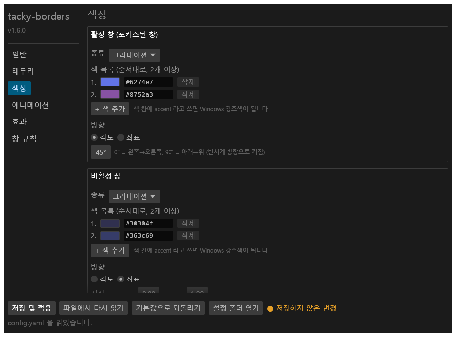
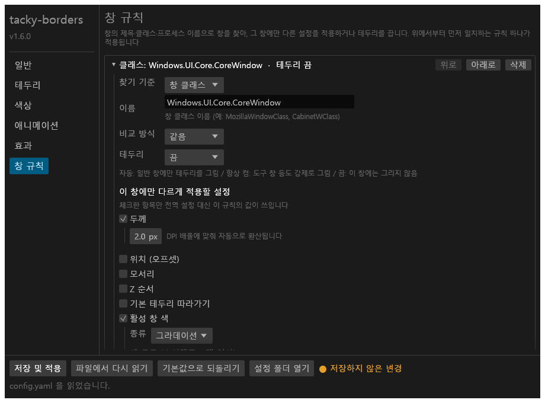

# tacky-borders


_tacky-borders_ lets you customize window borders on Windows 10 and 11.

## Installation

### Pre-built Release

The easiest way to install _tacky-borders_ is to download a pre-built release from the [releases](https://github.com/luke-you/tacky-borders/releases) page.

When you run the .exe for the first time, _tacky-borders_ will automatically generate a config file for you in ```%userprofile%/.config/tacky-borders/```.

### Build It Yourself

Alternatively, if you wish to build it yourself, you can follow these steps:

1. Install the necessary tools:
   - [Rust](https://www.rust-lang.org/tools/install)
   - [MSVC build tools](https://visualstudio.microsoft.com/downloads/)
2. Clone the repository:

   ```sh
   git clone https://github.com/luke-you/tacky-borders.git
   ```

3. Navigate to the project directory:

   ```sh
   cd tacky-borders
   ```

3. Build or run the project:

   ```sh
   cargo build --release
   ```

   or

   ```sh
   cargo run --release
   ```

## Uninstallation

To uninstall, it's as easy as deleting `tacky-borders.exe`.

> [!NOTE]
> If you wish to remove all traces of _tacky-borders_ from your system, you should also ensure auto-start is disabled via the tray menu and delete the config folder located at ```%userprofile%/.config/tacky-borders/```

## 설정 GUI (this fork)

원본 _tacky-borders_ 는 `config.yaml` 을 텍스트 편집기로 직접 고쳐야 합니다. 이 포크는 트레이 메뉴에서 여는 **한글 설정 창**을 추가해, 설정 파일 스펙을 몰라도 모든 옵션을 화면에서 고치고 바로 적용할 수 있게 합니다.



### 여는 방법

- 트레이 아이콘을 오른쪽 클릭하고 **설정...** 을 고릅니다.
- 또는 _tacky-borders_ 가 실행 중일 때 명령줄에서 `tacky-borders.exe settings` 를 실행합니다. (일반 페이지의 "IPC 서버 사용" 이 켜져 있어야 합니다.)

### 화면 구성

왼쪽 목록에서 페이지를 고르면 오른쪽에 해당 항목이 나옵니다. 각 항목 옆의 회색 설명과 마우스를 올렸을 때 나오는 도움말이 `config.yaml` 의 주석을 대신합니다.

| 페이지 | 다루는 설정 |
| --- | --- |
| 일반 | 설정 파일 경로, 설정 파일 변경 감시, 로그 기록, IPC 서버, 렌더러(V2 / Legacy) |
| 테두리 | 두께, 위치(오프셋, 면마다 다르게 지정 가능), 모서리, Z 순서, 기본 테두리 따라가기, 새 창·복원 지연 |
| 색상 | 활성 창 / 비활성 창 색. 단색, Windows 강조색, 그라데이션(각도 또는 좌표), 테마별(다크 / 라이트)을 고르고 색상 피커로 편집. komorebi 연동 색 |
| 애니메이션 | 활성 / 비활성 창의 애니메이션 목록(Spiral, ReverseSpiral, Fade), 길이, 가속 곡선, 프레임 속도 |
| 효과 | 활성 / 비활성 창의 효과 목록(Shadow, Glow), 흐림, 퍼짐, 불투명도, 이동 |
| 창 규칙 | 창 클래스 / 제목 / 프로세스 이름으로 창을 찾아 테두리를 켜고 끄거나, 그 창에만 다른 설정을 덮어쓰는 규칙 목록. 순서 변경과 추가·삭제 |



창 규칙에서는 "이 창에만 다르게 적용할 설정" 에서 체크한 항목만 전역 설정 대신 쓰입니다. 체크하지 않은 항목은 전역 설정을 그대로 따릅니다.

### 저장과 적용

- **저장 및 적용**: `config.yaml` 을 쓰고 실행 중인 테두리에 곧바로 반영합니다. 다시 시작할 필요가 없습니다.
    - 저장 전에 색상 형식, 그라데이션 색 개수, 규칙 이름과 정규식을 검사하고, 문제가 있으면 저장하지 않고 상태줄에 이유를 보여 줍니다.
- **파일에서 다시 읽기**: 화면의 변경을 버리고 `config.yaml` 을 다시 읽습니다.
- **기본값으로 되돌리기**: 원본과 같은 기본 설정을 화면에 불러옵니다. 저장해야 적용됩니다.
- **설정 폴더 열기**: `%userprofile%\.config\tacky-borders` 폴더를 탐색기로 엽니다.
- 저장하지 않은 변경이 있으면 제목 표시줄에 `*` 가, 아래쪽에 "저장하지 않은 변경" 표시가 나타나고, 창을 닫을 때 저장 여부를 묻습니다.

### 알아둘 점

- 설정 파일 위치와 형식은 원본과 같습니다. 텍스트 편집기로 직접 고치는 방법도 그대로 쓸 수 있고, "설정 파일 변경 감시" 가 켜져 있으면 저장 즉시 반영됩니다.
- 설정 창에서 저장하면 `config.yaml` 을 통째로 다시 씁니다. 각 항목에 한글 설명 주석이 자동으로 붙지만, 사용자가 손으로 써 둔 주석은 사라집니다.
- 창을 닫아도 프로그램은 숨기기만 하므로 다음에 즉시 열립니다. 다시 열 때 저장하지 않은 변경이 없으면 `config.yaml` 을 새로 읽습니다.
- 트레이 메뉴 항목도 한글입니다: 설정..., 설정 폴더 열기, 자동 시작, 다시 불러오기, 종료.
- 한글 글꼴은 Windows 의 맑은 고딕을 실행 시 읽어 씁니다.

### 개발자용

- `cargo run --example settings_window` 로 데몬 없이 설정 창만 띄울 수 있습니다.
- `cargo test --lib settings_gui -- --ignored` 는 각 페이지를 헤드리스로 렌더링해 `target/settings_gui_snapshots/*.png` 로 남깁니다. 위 스크린샷도 이 방법으로 만든 것입니다.

### Settings GUI (English summary)

This fork adds a Korean-language settings window so that `config.yaml` does not have to be edited by hand.

- Open it from the tray menu (**설정...**) or with `tacky-borders.exe settings` while the daemon is running.
- Pages: general, border, colors, animations, effects and window rules. Every option in `config.yaml` can be edited, including per-rule overrides.
- **저장 및 적용** (save and apply) validates the input, rewrites `config.yaml` with Korean comments on every option, and reloads the borders immediately. Hand-written comments are not preserved.
- Closing the window only hides it; it re-reads `config.yaml` when reopened unless there are unsaved edits.
- The tray menu is in Korean in this fork.

## Configuration Options

The config file is located in ```%userprofile%/.config/tacky-borders/```. You can easily access this folder by right clicking on the tray icon and hitting "설정 폴더 열기" (Show Config). In this fork, every option below can also be edited from the settings window described above.

The following auto-generated config.yaml is included as reference:

```yaml
# watch_config_changes: Automatically reload borders whenever the config file is modified.
watch_config_changes: True

# enable_logging: Log messages (info, warnings, and errors) to a file.
# NOTE: Changes require an application restart to take effect.
enable_logging: True

# enable_ipc_server: Handle runtime IPC commands sent through the CLI.
enable_ipc_server: True

# rendering_backend: Type of renderer. Supported values:
#   - V2: A more complex, feature-rich renderer. Available in v1.2.0 and above.
#   - Legacy: A simpler, more limited renderer. Available in v0.1.0 and above.
#
# NOTE: Performance between the two may vary system-to-system. Choose whichever works best.
rendering_backend: V2

# Global configuration options
global:
  # border_width: Width of the border (in pixels)
  border_width: 3

  # border_offset: Offset of the border from the window edges (in pixels)
  #   - Negative values shrink the border inwards
  #   - Positive values expand the border outwards
  border_offset: -1

  # border-radius: Radius of the border's corners. Supported values:
  #   - Auto: Automatically determine the radius
  #   - Square: Sharp corners (radius = 0)
  #   - Round: Fully rounded corners
  #   - RoundSmall: Slightly rounded corners
  #   - Or specify any numeric value for a custom radius
  border_radius: Auto

  # border_z_order: Z-order of the border relative to its window. Supported values:
  #   - AboveWindow: Place the border above its window
  #   - BelowWindow: Place the border below its window
  #
  # NOTE: Using 'AboveWindow' may cause the border to flicker when used with some applications
  # that manipulate window layering, leading to z-order conflicts.
  border_z_order: AboveWindow

  # follow_native_border: Follow Windows' behavior for border visibility.
  #
  # Windows already shows or hides native borders depending on a window's type or state
  # (e.g., they're hidden for borderless fullscreen windows). When enabled, this option makes
  # tacky-borders follow that visibility behavior.
  #
  # NOTE: This setting only affects visibility for borders that have been initialized.
  # To make sure a border is initialized in the first place, use window_rules.
  follow_native_border: True

  # initialize_delay: Time (in ms) before the border appears after opening a new window
  # unminimize_delay: Time (in ms) before the border appears after unminimizing a window
  #
  # These settings help accommodate window animations (e.g., open or unminimize animations).
  # Set these to 0 if window animations are disabled.
  #
  # These can also be used to accommodate border animations (e.g., fade animations).
  initialize_delay: 200
  unminimize_delay: 150

  # active_color: the color of the active window's border
  # inactive_color: the color of the inactive window's border
  #
  # Supported color types:
  #   - Solid: Use a hex code or "accent"
  #       Example:
  #         active_color: "#ffffff"
  #         OR
  #         active_color: "accent"
  #       The supported hex formats are: #RGB, #RGBA, #RRGGBB, #RRGGBBAA
  #   - Gradient: Define colors and direction
  #       Example:
  #         active_color:
  #           colors: ["#000000", "#ffffff"]
  #           direction: 45deg
  #         OR
  #         active_color:
  #           colors: ["#000000", "#ffffff"]
  #           direction:
  #             start: [0.0, 1.0]
  #             end: [1.0, 0.0]
  #       NOTE: [0.0, 0.0] = top-left, [1.0, 1.0] = bottom-right
  #   - Theme-aware: Define separate colors for dark/light Windows system themes
  #       Example:
  #         active_color:
  #           dark: "#ffffff"
  #           light: "#000000"
  #       Each value (dark/light) can be a hex code, "accent", or a gradient.
  #       Borders automatically update when the system theme changes.
  active_color:
    colors: ["#6274e7", "#8752a3"]
    direction: 45deg

  inactive_color:
    colors: ["#30304f", "#363c69"]
    direction:
      start: [0.0, 1.0]
      end: [1.0, 0.0]

  # komorebi_colors: Additional integration for komorebi's special window kinds
  #   - active_color is used for komorebi's "Single" window kind
  #   - inactive_color is used for komorebi's "Unfocused" window kind
  komorebi_colors:
    stack_color: "#e762b7"
    monocle_color: "#62e793"
    floating_color: "#f5f5a5"
    enabled: False

  # animations: Configure animation behavior for window borders
  #   active: Animations for active windows
  #   inactive: Animations for inactive windows
  #   fps: Animation frame rate
  #
  # Supported animation types:
  #   - Spiral
  #   - ReverseSpiral
  #   - Fade
  #
  # Specify animation types and parameters as follows:
  #   active:
  #     - type: ReverseSpiral
  #       duration: 1800
  #       easing: Linear
  #
  #     - type: Fade
  #       duration: 200
  #       easing: EaseInOutQuad
  #
  # NOTE: Spiral animations may be resource-intensive on low-end systems.
  animations:
    active:
      - type: ReverseSpiral
        duration: 1800
        easing: Linear

      - type: Fade
        duration: 200
        easing: EaseInOutQuad

    inactive:
      - type: Spiral
        duration: 1800
        easing: Linear

      - type: Fade
        duration: 200
        easing: EaseInOutQuad

    fps: 60
    enabled: False

  # effects: Configure visual effects for window borders
  #   active: Effects for active windows
  #   inactive: Effects for inactive windows
  #
  # Supported effect types:
  #   - Shadow
  #   - Glow
  #
  # Specify effect types and parameters as follows:
  #   active:
  #    - type: Shadow
  #      blur: 2.0
  #      spread: 0.0
  #      opacity: 1.0
  #      translation:
  #        x: 0
  #        y: 20
  #
  #    - type: Glow
  #      blur: 8.0
  #      spread: 0.0
  #      opacity: 1.0
  #
  # NOTE: These effects can significantly increase CPU and GPU usage.
  # Additionally, effects require rendering_backend: V2 to work.
  effects:
    active:
      - type: Shadow
        blur: 2.0
        spread: 0.0
        opacity: 1.0
        translation:
          x: 0
          y: 0

      - type: Glow
        blur: 8.0
        spread: 0.0
        opacity: 1.0

    inactive:
      - type: Shadow
        blur: 2.0
        spread: 0.0
        opacity: 1.0
        translation:
          x: 0
          y: 0

      - type: Glow
        blur: 8.0
        spread: 0.0
        opacity: 1.0

    enabled: False

# Per-application configuration overrides
window_rules:
  - match: Class
    name: "Windows.UI.Core.CoreWindow"
    enabled: False

  - match: Class
    name: "XamlExplorerHostIslandWindow"
    enabled: False

  - match: Process
    name: "tacky-borders"
    enabled: False

  - match: Process
    name: "zebar"
    enabled: False

  - match: Title
    name: "komorebi-bar"
    enabled: False

  - match: Title
    name: "keyviz"
    enabled: False

  - match: Title
    name: "Picture-in-Picture"
    enabled: False

  - match: Process
    name: "seelen-ui"
    enabled: False

  # Example rule:
  # - match: Class                   # Match based on Class, Title, or Process
  #   name: "MozillaWindowClass"     # Class/title/process name to match
  #   strategy: Equals               # Matching strategy: Equals, Contains, or Regex (default: Equals)
  #   enabled: True                  # Enable border initialization: True, False, or Auto (default: Auto)
  #
  # NOTE:
  #   - Any option in the global config can also be defined in window_rules.
  #   - If not defined in a rule, settings will fall back to global config values.
  #   - Setting 'border enabled' to True forces its initialization, but not necessarily its visibility.
  #     If the border still isn't visible, try setting 'follow_native_border' to False.
```

## Community Projects

- [Color-Presets-for-Tacky-Borders](https://github.com/landnthrn/Color-Presets-for-Tacky-Borders) - Additional color presets including color animations, gradients, one side color fades, and static colors.

## Comparison to cute-borders

Here is another great app that achieves similar functionality: <https://github.com/keifufu/cute-borders>. I've taken a lot of inspiration from them and would highly recommend checking them out!

Although both apps aim to customize window borders, they have totally different implementations, each with their own strengths and limitations. Which one you should use boils down to the following:

**Choose _tacky-borders_ if you want**:

- Customizable border width
- Gradient support
- Multiple animation types
- Windows 10 support (not fully tested, but it has been reported to work)

**Choose _cute-borders_ if you want**:

- Stability and performance due to its use of native Windows API for the borders.
